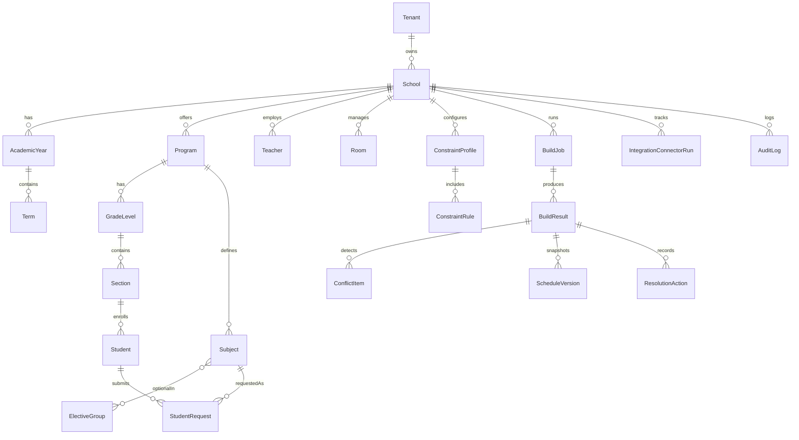

# SCAS Initial ERD (Trimester + SHS Electives)

## Notes

- `Term` supports trimester and semester setups (`term_index`, `start_date`, `end_date`).
- `ElectiveGroup` allows SHS strand-specific pools with min/max pick counts.
- `StudentRequest` stores ranked elective preferences and approval status.
- `BuildJob` keeps orchestration state while `BuildResult` stores immutable outputs.
